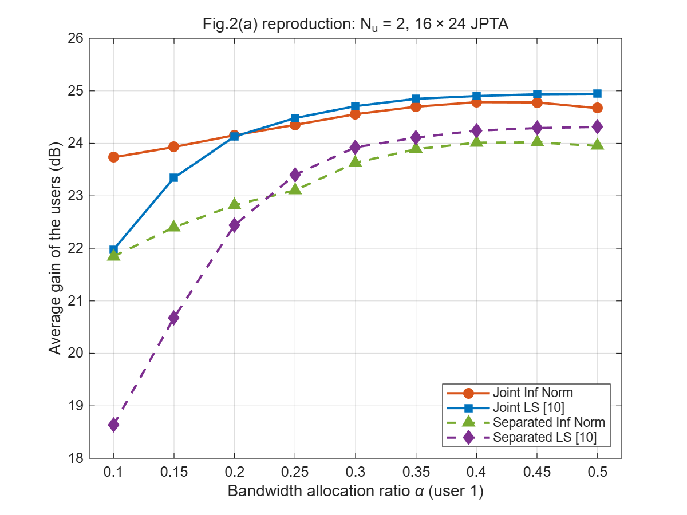
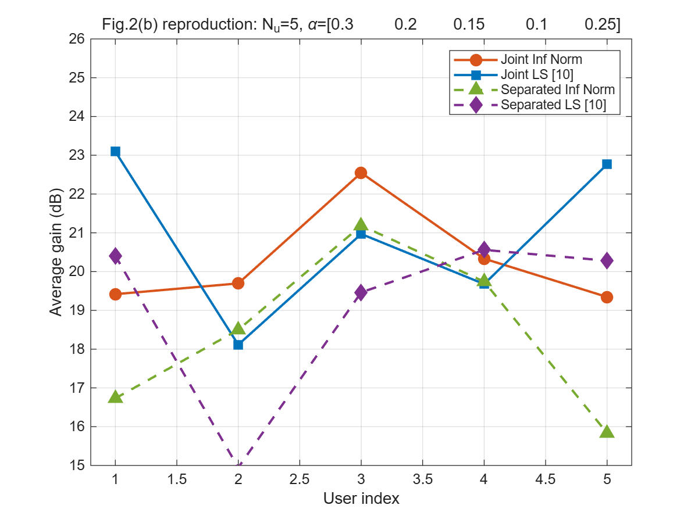
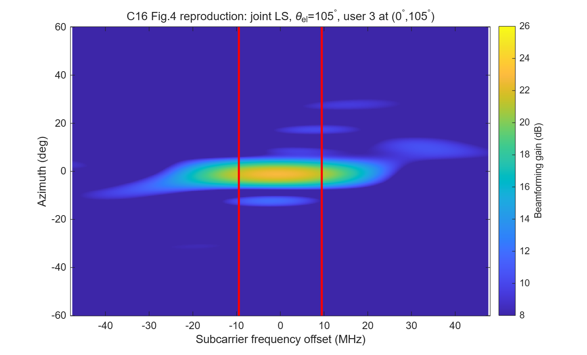
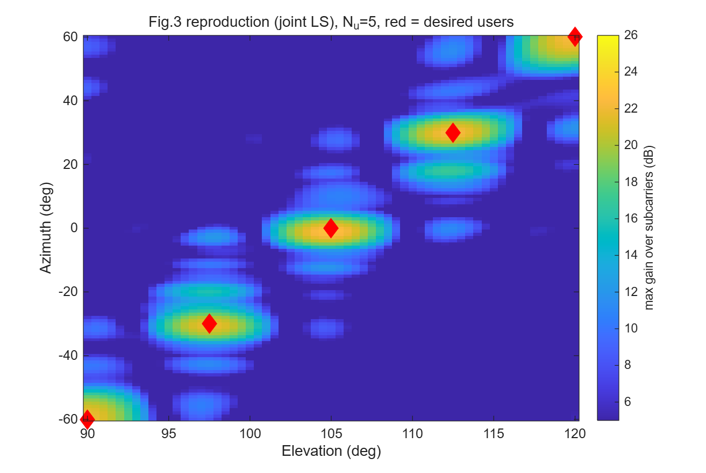
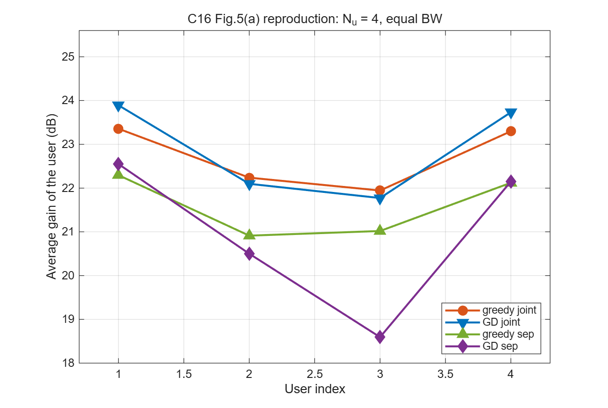
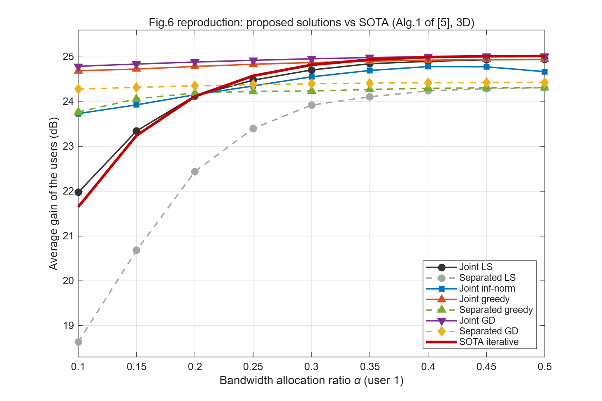

# JPTA-3D-Beamforming

[中文](README.zh.md) | English

MATLAB reproduction of all simulation results in:

> O. Yildiz, A. AlAmmouri, J. Mo, Y. Nam, E. Erkip, J. Zhang,
> "3D Beamforming Through Joint Phase-Time Arrays", arXiv:2401.00819v3, Aug. 2024.

A joint phase-time array (JPTA) puts one true-time-delay (TTD) unit behind each antenna
element, so the analog beam becomes frequency dependent and a single RF chain can serve
several users in different directions at the same time, each on its own sub-band. This
paper asks the design question that the earlier one-dimensional ("rainbow beam") work left
open: **given a set of users that own contiguous sub-bands, how should the 2-D phase
shifters and the TTDs of a planar array be set so that every user sees the largest possible
gain in its own band?** It gives an analytical least-squares solution, an infinity-norm
variant, a greedy algorithm and a gradient-descent algorithm, and compares all of them.

This repository is an independent implementation of every simulatable result in the paper
(Figs. 2–7), with a point-by-point numerical comparison and a list of everything that does
not reproduce exactly.

> **How this was produced**: the code, the numbers and this documentation were produced with
> **DeepSeek-V4.1-Flash**, without access to the authors' code. The one exception is Fig. 6
> and Fig. 7, which compare against the earlier JPTA paper (ref. [5] there); that baseline
> was re-implemented from the published algorithm, see §6.

- Result report (per-figure tables, gap list, pitfalls): [`REPORT.md`](REPORT.md) ([中文](REPORT.zh.md))
- Simulation code: [`matlab/`](matlab/)
- Paper: `3D Beamforming Through Joint Phase-Time Arrays (arXiv 2401.00819).pdf`

---

## 1. Summary of results

| Figure | Content | Outcome |
|---|---|---|
| Fig. 2(a) | average gain vs bandwidth split `α`, 2 UEs, 4 designs | Reproduced point by point; joint − separated gap **0.63–3.34 dB** (paper 0.6–4), means 1.36 / 1.11 dB (paper 1.29 / 1.18) |
| Fig. 2(b) | 5 UEs, per-user gain and fairness | 3 of 4 designs within 0.2 dB; the separated infinity-norm case misses (5.35 dB spread vs 3.2, gap **G1**) |
| Fig. 3 | azimuth–elevation patterns, joint vs separated | Same qualitative difference (separated leaks a striped pattern over the whole plane); band-edge user sits 3.8 dB below the peak, consistent with Fig. 2(b) |
| Fig. 4 | azimuth–frequency heat map, 5 UEs | User 3 is confined to **[−9.48, 9.48] MHz** (paper: [−9.5, 9.5)), in-band 22.04 dB, out-of-band 8.14 dB |
| Fig. 5 | greedy (Algorithm 1) and Adam gradient descent, joint/separated | End points reproduced to **≤0.4 dB per user**; greedy ≡ Algorithm 1 verified to 3.6e−14; the paper's "+2.26/+2.11 dB over the start point" does not reproduce (gap **G5**) |
| Fig. 6 | comparison against Algorithm 1 of ref. [5] | Shape and qualitative claims hold, but the claimed "up to **1.54 dB**" comes out as **0.33 dB** (gap **G7**) |
| Fig. 7 | run time, gradient descent vs the SOTA iteration | Ratio **7.6–23.7×** (paper 5.5×); the claim "at least 5×" holds, absolute times are implementation-specific |

Two claims are checked in a form that does not depend on reading numbers off a plot:

1. **the greedy algorithm in the paper is Algorithm 1** — an incremental implementation
   (update one element, reuse the rest of the array factor) and a literal implementation
   (recompute eq. (5) for every candidate) agree to $3.6\times10^{-14}$ with the same
   search grid, so "algorithm" and "implementation" can be separated for the rest of the study;
2. **the objective cannot exceed the array bound** — $10\log_{10}(16\times24)=25.843$ dB, and
   the largest value ever observed is 25.8433 dB.

---

## 2. Quick start

```matlab
cd matlab
run_all              % self-check and all seven experiments, about 6 min
```

Single experiment (each job rewrites only its own files in `matlab/out/`):

```matlab
run_all('selftest')   % kernel self-check, 4 invariants          ~1 s
run_all('fig2a')      % Fig. 2(a): 2 UEs, gain vs alpha          ~12 s
run_all('fig2b')      % Fig. 2(b): 5 UEs, per-user gain          ~11 s
run_all('fig3')       % Fig. 3 and Fig. 4                        ~27 s
run_all('fig5')       % Fig. 5: greedy and Adam GD               ~3.6 min
run_all('fig5conv')   % only the equivalence and start-point checks ~1.5 min
run_all('fig6')       % Fig. 6 and Fig. 7 (needs no other job)   ~2.0 min
```

All parameters are in `matlab/core/jp_params_c16.m` (one struct, every entry annotated with
the place in the paper it comes from). The low-level functions can be called directly after
`run_all` has put `core/` and `alg/` on the path:

```matlab
p = jp_params_c16();
[az, el] = jp_users_c16(2);
[phi, tau, info] = jp_design(p, az, el, [0.3 0.7], 'joint-ls');
R = jp_eval(p, phi, tau, az, el, jp_block(p, [0.3 0.7]));
```

**Environment**: MATLAB R2022a or later, no toolbox required (`fminbnd` from core MATLAB
replaces the linear program the paper suggests, see REPORT §2). Verified on R2026b.
Nothing is random, so every run gives the same numbers.

---

## 3. Repository layout

```
matlab/
  run_all.m              single entry point, dispatches per figure
  run_p0.m               kernel self-check (P0): 4 invariants
  run_a1.m               Fig. 2(a)
  run_a3.m               Fig. 2(b)
  run_a45.m              Fig. 3 and Fig. 4
  run_a6.m               Fig. 5 (5 sections: equivalence, 5(a), 5(b), run time, start point)
  run_a6_conv.m          sections 0 and 4 of run_a6 only
  run_a7.m               Fig. 6 and Fig. 7
  core/
    jp_params_c16.m      Table I of the paper, one struct
    jp_users_c16.m       user directions used by Figs. 2-5
    jp_block.m           sub-band partition of eq. (9)
    jp_nu.m              steering value of eq. (9)
    jp_mvec.m            subcarrier index vector m = -M/2 .. M/2
    jp_target_blocks.m   right-hand side b_{y,z} of eqs. (8)-(9)
    jp_unwrap_k.m        phase-unwrapping offsets of eq. (10)
    jp_unwrap_k_1d.m     same, for one array axis (separated design)
    jp_gain_freqs.m      array gain of eq. (3) at arbitrary frequencies
    jp_finalize.m        quantized PS phases and TTD delays from an (x1,x2) solution
    jp_design.m          dispatcher: joint-ls | joint-inf | sep-ls | sep-inf
    jp_eval.m            per-user gain, Gl of eq. (5)
    jp_filldef.m         option-struct helper
  alg/
    jp_ls_fit.m          closed-form LS of eqs. (11)-(13)
    jp_inf_fit.m         infinity-norm fit, exact one-dimensional convex form
    jp_greedy.m          Algorithm 1 (joint) and its separated counterpart
    jp_greedy_naive.m    literal Algorithm 1, used only for the equivalence check
    jp_gd.m              Adam gradient descent (joint / separated)
    jp_sota_iter.m       Algorithm 1 of ref. [5], lifted to 3-D (used by Fig. 6/7)
  out/                   figures (tracked) and .mat caches (ignored)
REPORT.md                reproduction report
README.zh.md             Chinese version of this file
REPORT.zh.md             Chinese version of the report
```

The hardware model is written once, in `jp_gain_freqs.m` (forward) and `jp_finalize.m`
(quantization), and every algorithm and figure goes through them. That rules out the class
of bug where "Fig. 2 and Fig. 3 use slightly different conventions".

---

## 4. Simulation parameters

Table I of the paper, all in `jp_params_c16.m`:

| Symbol | Meaning | Value |
|---|---|---|
| `fc` | carrier frequency | 28 GHz |
| `BW` | system bandwidth | 95 MHz |
| `df` | subcarrier spacing | 120 kHz |
| `M+1` | number of subcarriers | 793 (`m = −396…396`) |
| `Naz × Nel` | planar array | 16 × 24 = 384 elements, half-wavelength spacing |
| `tau_p` | TTD quantization step | 2.5 ns |
| `tau_max` | TTD range | 200 ns |
| `beta_ps` | phase shifter resolution | 6 bit |
| bound | max array gain | $10\log_{10}384 = 25.843$ dB |

The users of Figs. 2–5 are fixed: azimuth $[-60^\circ, 60^\circ]$ for 2 UEs,
$[-60,-30,0,30,60]^\circ$ with elevation $[90,97.5,105,112.5,120]^\circ$ for 5 UEs. The
bandwidth fractions α are `0.10:0.05:0.50` in Figs. 2(a) and 6, `[0.3 0.2 0.15 0.1 0.25]` in
Figs. 2(b)–5.

---

## 5. Reproduction results

<table>
<tr>
<td align="center"><br><sub>Fig. 2(a) — gain vs bandwidth split, 2 UEs</sub></td>
<td align="center"><br><sub>Fig. 2(b) — 5 UEs, per-user gain</sub></td>
</tr>
<tr>
<td align="center"><br><sub>Fig. 4 — azimuth–frequency heat map</sub></td>
<td align="center"><br><sub>Fig. 3 — azimuth–elevation pattern (joint)</sub></td>
</tr>
<tr>
<td align="center"><br><sub>Fig. 5(a) — greedy and GD, 4 UEs</sub></td>
<td align="center"><br><sub>Fig. 6 — against Algorithm 1 of ref. [5]</sub></td>
</tr>
</table>

### 5.1 Fig. 2(a): joint beats separated, by how much

Mean gain $\frac1{N_u}\sum_i 10\log_{10}\bar G_i$ (dB):

| α | Joint-∞ | Joint-LS | Sep-∞ | Sep-LS | Δ(J−S) LS | Δ(J−S) ∞ |
|---|---|---|---|---|---|---|
| 0.10 | 23.734 | 21.975 | 21.847 | 18.634 | +3.34 | +1.89 |
| 0.20 | 24.154 | 24.129 | 22.824 | 22.439 | +1.69 | +1.33 |
| 0.30 | 24.555 | 24.708 | 23.631 | 23.925 | +0.78 | +0.92 |
| 0.40 | 24.784 | 24.901 | 24.012 | 24.242 | +0.66 | +0.77 |
| 0.50 | 24.671 | 24.944 | 23.951 | 24.312 | +0.63 | +0.72 |

| Claim | Paper | Reproduced |
|---|---|---|
| the joint design always wins, by 0.6–4 dB | 0.6–4 dB | **0.63–3.34 dB** |
| mean gap, LS | 1.29 dB | **1.36 dB** |
| mean gap, infinity norm | 1.18 dB | **1.11 dB** |
| infinity norm better than LS for α ≤ 0.2 | yes | yes (+1.76/+0.58/+0.03 dB joint, +3.21/+1.72/+0.39 dB separated) |

### 5.2 Fig. 2(b): five users

| Design | U1 | U2 | U3 | U4 | U5 | Max spread | Paper |
|---|---|---|---|---|---|---|---|
| Joint-∞ | 19.42 | 19.70 | 22.55 | 20.33 | 19.34 | **3.20** | 3.0 |
| Joint-LS | 23.10 | 18.11 | 20.97 | 19.68 | 22.77 | **4.98** | 5.0 |
| Sep-∞ | 16.73 | 18.50 | 21.19 | 19.74 | 15.84 | 5.35 | 3.2 |
| Sep-LS | 20.41 | 14.95 | 19.46 | 20.56 | 20.28 | **5.61** | 5.4 |

Three of four match to 0.2 dB. The fourth is a definition issue, not a tuning issue: applying
the infinity norm per array axis is not the same as minimising the spread of the product
gain across users (gap **G1**).

### 5.3 Fig. 3 and Fig. 4

A strong independent check comes for free: the paper says user 3 owns $[-9.5, 9.5)$ MHz, and
the subcarrier rule of eq. (9) gives $m=-79\ldots79$, i.e. $[-9.48, 9.48]$ MHz — a 0.02 MHz
agreement, which validates the rounding convention of the band edges.

In-band gain at user 3 is 22.04 dB against a bound of 25.84 dB, i.e. the joint LS design loses
about 3.8 dB on an equal-bandwidth 5-user split — exactly what Fig. 2(b) shows per user. The
separated design, in contrast, spreads a striped sidelobe pattern over the whole
azimuth–elevation plane instead of five compact spots.

### 5.4 Fig. 5: greedy and gradient descent

$N_u=4$, equal bands, per-user gain (dB):

| Design | U1 | U2 | U3 | U4 | Mean | Iterations |
|---|---|---|---|---|---|---|
| joint LS (start) | 23.27 | 21.76 | 21.36 | 23.19 | 22.394 | – |
| joint greedy (Alg. 1) | 23.36 | 22.24 | 21.94 | 23.30 | **22.709** | 4 |
| joint Adam GD | 23.89 | 22.10 | 21.77 | 23.73 | **22.874** | 194 |
| separated greedy | 22.30 | 20.91 | 21.02 | 22.12 | **21.587** | 8 |
| separated Adam GD | 22.55 | 20.50 | 18.59 | 22.15 | 20.949 | 77 |
| *paper*, joint greedy | 23.35 | 22.25 | 21.90 | 23.05 | *22.64* | |
| *paper*, joint GD | 23.50 | 21.85 | 21.70 | 23.45 | *22.62* | |
| *paper*, separated greedy | 21.70 | 21.10 | 21.10 | 22.35 | *21.56* | |
| *paper*, separated GD | 22.20 | 21.10 | 20.15 | 21.30 | *21.19* | |

(joint greedy ≤0.25 dB per user, joint GD ≤0.39 dB; "comparable" holds, mean |GD−greedy| =
0.088 dB joint, 0.194 dB separated.)

Three things had to be added that the paper does not spell out, and they are the reason the
gradient descent works at all: one learning rate cannot serve φ (radians) and τ (seconds)
(gap **G2**), Adam leaves the feasible delay window within a few steps unless it is
reparameterised (gap **G3**), and the greedy convergence test fires at the first iteration
when applied to GD (gap **G4**). All three are documented in REPORT §5.

### 5.5 Fig. 6 and Fig. 7: against the state of the art

The comparison baseline is Algorithm 1 of the earlier JPTA paper (ref. [5] of this paper),
lifted to 3-D here. It reaches 25.843 dB on a single user over the full band and beats the
C16 analytical design on its own objective ($F=14047.0$ vs $13928.3$ at α=0.5), so it is not
a weakened straw man.

| Claim | Paper | Reproduced |
|---|---|---|
| for α > 0.35 all joint designs converge to the same outcome | qualitative | **holds**: spread of the five joint methods is 0.22 / 0.24 / 0.35 dB |
| for α ≤ 0.35 the one-shot analytical design beats the SOTA by up to 1.54 dB | 1.54 dB | **0.33 dB** — not reproduced, gap **G7** |
| for α ≤ 0.2, GD + separated beats everything but GD + joint | qualitative | **holds** (24.28 vs 23.73 dB at α=0.10) |
| GD is at least 5× slower than the SOTA iteration | ≥5× | **7.6–23.7×**, mean 12.8× (paper 5.5×) |

The missing 1.54 dB is the one number in this paper that does not come out, and the reason is
diagnosable: the two designs optimise different functionals ($\sum_k\sqrt{G_k}$, every
*subcarrier* equal, versus $\sum_i\log$ of the per-user mean, every *user* equal). Judged by
its own functional the SOTA wins at every α; judged by the C16 functional it loses below
α = 0.25. "The SOTA is 1.54 dB behind" is therefore partly "a design scored by someone else's
metric". What remains cannot be pinned down, because the paper says "compute $\tau_n$ using
either (8a) or Lemma 1" and the two readings differ by 8 dB in this problem (gap **G7**).

---

## 6. Known deviations

| ID | Item | Handling |
|---|---|---|
| **G1** | separated infinity-norm: 5.35 dB spread vs 3.2 in the paper | minimax per axis is not minimax of the product gain; both readings reported |
| **G2** | one learning rate 0.1 for both φ and τ | reparameterised to the only pair of variables for which 0.1 rad is meaningful |
| **G3** | unconstrained Adam leaves τ ∈ [0, 200] ns | bounded reparameterisation $b=B_{\max}\sigma(u)$ |
| **G4** | the greedy convergence test is not applicable to GD | 20-iteration sliding window for GD, per-round test for the greedy |
| **G5** | "+2.26/+2.11 dB over the start point" | the end points reproduce, the increment does not: it requires a start point of 20.4–20.6 dB, i.e. the separated LS, not the joint LS the paper plots |
| **G6** | separated GD is 1.56 dB low on user 3 | left open; the direction (separated design is worse) agrees with the paper |
| **G7** | the "1.54 dB" of Fig. 6 | Lemma 1 reading gives 0.33 dB, eq. (8a) reading gives 8.71 dB; the text does not say which |
| **G8** | target beam $\bar b_k$ under multi-user FDM is this work's extension | the only self-consistent choice; anchored by $|\bar b_k^\dagger TPd_k|=\sqrt{G_k}$ |
| **G9** | number of TTD units in the 3-D lift is not stated | $N=M=384$, one per element, matching this paper's hardware model |

---

## 7. Pitfalls

In the order they were hit; the full list is in [`REPORT.md`](REPORT.md) §5.

1. **The subcarrier phase of eq. (3) already contains π.** `jp_nu` returns
   $\nu=y\pi\sin\theta_{az}\sin\theta_{el}+z\pi\cos\theta_{el}$; multiplying by π again in the
   gain expression inflated every phase difference by π and made the self-check return
   8.35 dB instead of 25.84 dB. A 17 dB error that is invisible without the first assertion.
2. **No `linprog` on the compute node.** The infinity-norm fit is rewritten as the equivalent
   one-dimensional convex problem (for a given slope $x_2$, the optimal intercept is the
   mid-range of $b-x_2m$ and $t(x_2)$ is convex in $x_2$), solved by `fminbnd`. Exact, no
   toolbox, and about 10× faster than the per-element LP.
3. **Phase unwrapping decides whether Fig. 2(a) reproduces.** Adding the integer $2\pi k_i$ of
   eq. (10) across user blocks is what makes the analytical target usable; taking the raw
   steering value gives −3.05/−4.60 dB at $N_u=2,\alpha=0.1$ instead of 22.1/18.1 dB.
4. **The literal Algorithm 1 is 150× slower and numerically identical.** That is why it is
   kept in the repository: it is the evidence that the fast version is the same algorithm.
5. **MATLAB console encoding.** `-batch` on the compute node runs on a GBK console, so all
   console output is ASCII; Chinese only appears in the documentation.

---

## 8. Self-check

`run_all('selftest')` asserts four invariants before anything else is allowed to run. Since
the objective has a known bound, this doubles as a unit test:

| # | Invariant | Result |
|---|---|---|
| 1 | $N_u=1,\alpha=1$ degenerates to a pure phased array: constant delays, flat gain | PASS: max\|τ\| = 0, gain 25.839 dB, ripple 0.003 dB |
| 2 | no design exceeds $10\log_{10}(16\times24)=25.843$ dB | PASS: max observed 25.8433 dB |
| 3 | with one row ($N_{el}=1$) the joint and separated designs coincide | PASS: max\|ΔG\| = 0, max\|Δτ\| = 0 |
| 4 | required delay stays inside $\tau_{\max}=200$ ns | PASS: spans 15.5 / 33.8 / 78.0 / 133.9 ns for $N_u$ = 2/4/8/16 |

---

## 9. Companion repositories

The same group's two other JPTA papers are reproduced in the same style:

| Repository | Paper | What it adds |
|---|---|---|
| `JPTA2022` | Ratnam et al., *Joint Phase-Time Arrays: A Paradigm for Frequency-Dependent Analog Beamforming in 6G*, IEEE Access 2022 | the original JPTA formulation, Algorithms 1–3, the HBF comparison; **this is ref. [5] of the present paper** |
| `JPTA-System-Design` | Mo et al., *Beamforming with Joint Phase and Time Array: System Design, Prototyping and Performance*, arXiv:2502.00139 | 2-D type-1/type-2 codebooks, TTD resolution, system-level throughput |
| `JPTA-Uplink-Coverage` | AlAmmouri et al., *Extending Uplink Coverage of mmWave and Terahertz Systems Through JPTA*, IEEE Access 2022 | uplink link budget, HARQ, coverage radius scaling |

The three differ in array, in what the design variables are and in what is being maximised,
so each has its own kernel; the models are compared in [`REPORT.md`](REPORT.md) §7.

---

## 10. Not covered

- Fig. 1 is a block diagram and Table I is parameter data; neither needs simulation.
- The 3-D hardware prototype demonstration is out of scope (it needs a testbed).
- The number of TTD units is swept only at $N=M$; the $N<M$ case (delays shared by
  sub-arrays) is left as an open question in REPORT §6, because it can only make the
  baseline weaker and is therefore a possible source of the missing 1.54 dB.

---

## Citation

```bibtex
@article{yildiz2024jpta3d,
  title   = {3D Beamforming Through Joint Phase-Time Arrays},
  author  = {Yildiz, Ozlem and AlAmmouri, Ahmad and Mo, Jianhua and Nam, Younghan
             and Erkip, Elza and Zhang, Jianzhong},
  journal = {arXiv preprint arXiv:2401.00819},
  year    = {2024}
}
```

This is an independent implementation; the authors' code was not used. Every discrepancy
with the published numbers is listed in [`REPORT.md`](REPORT.md).
