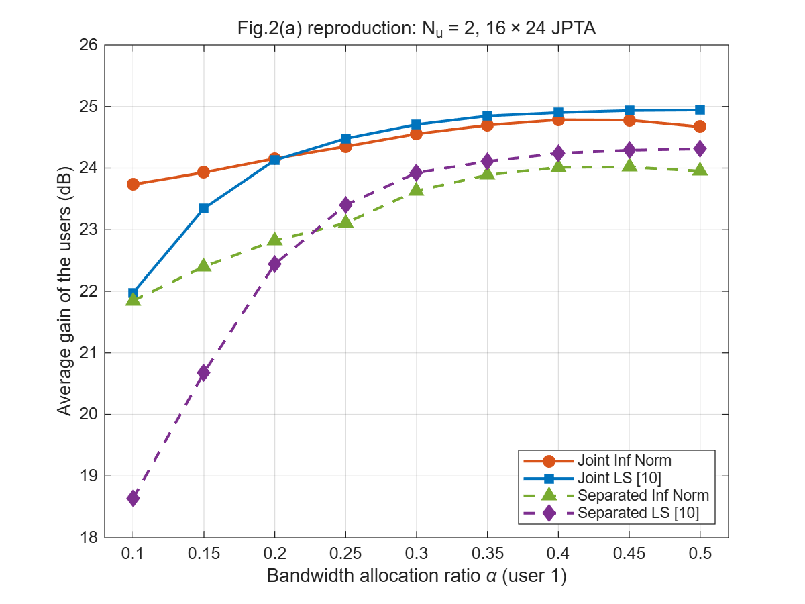
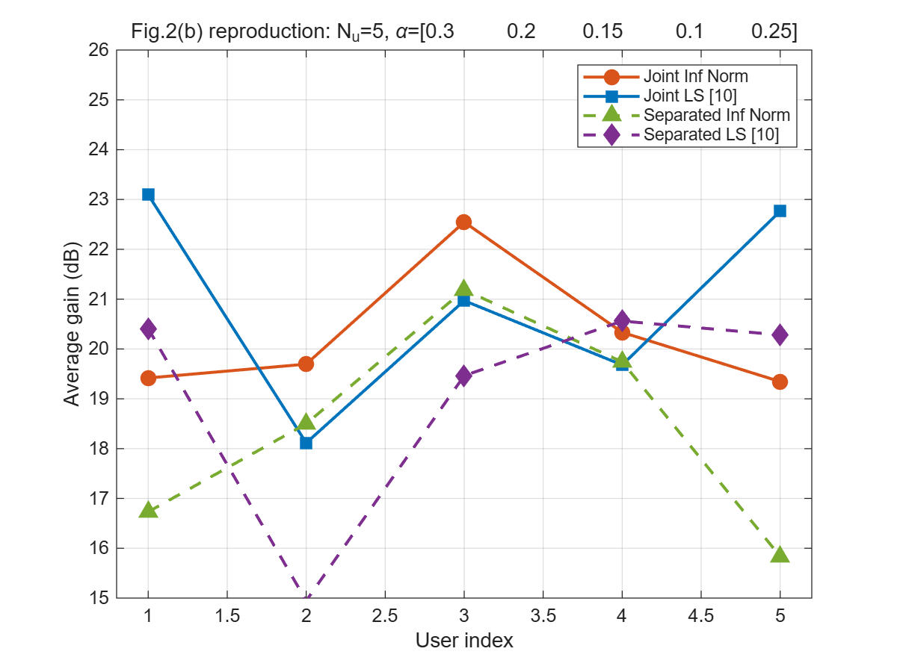
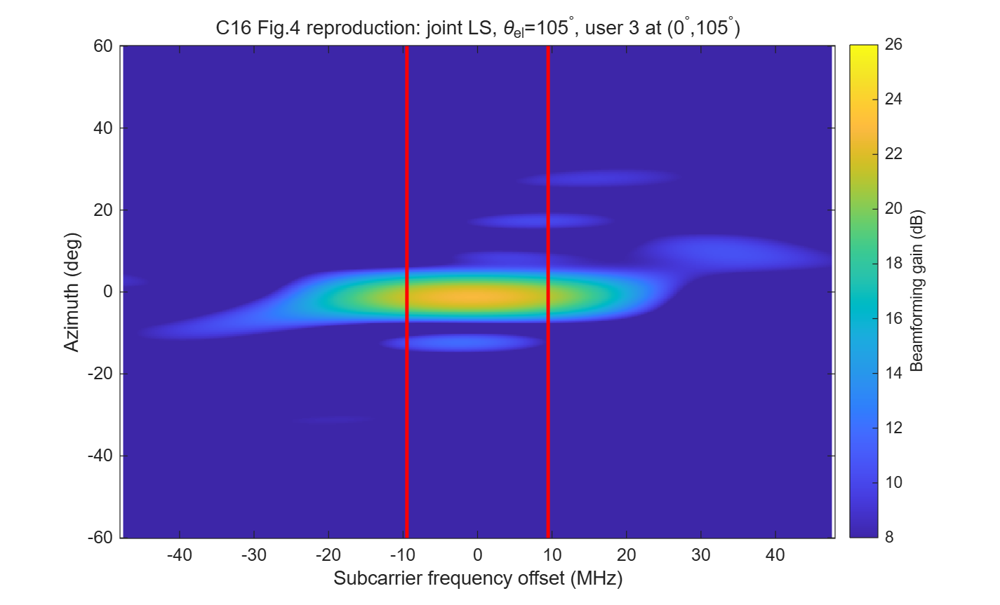
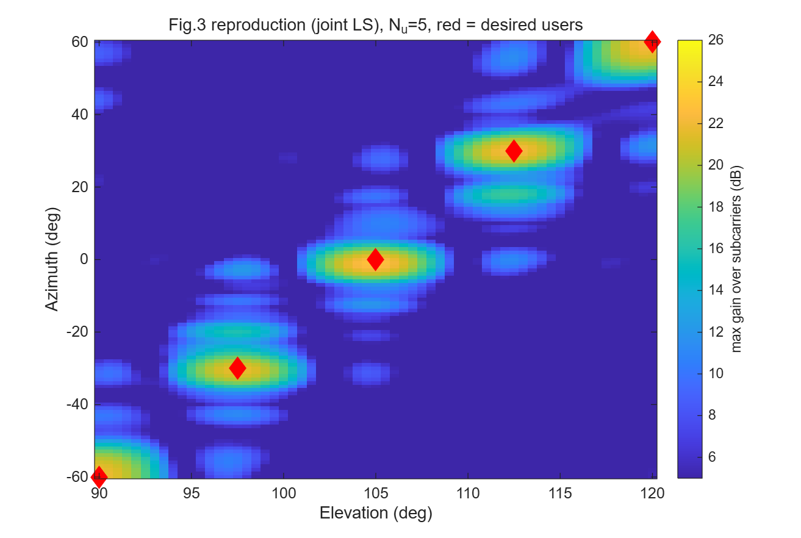
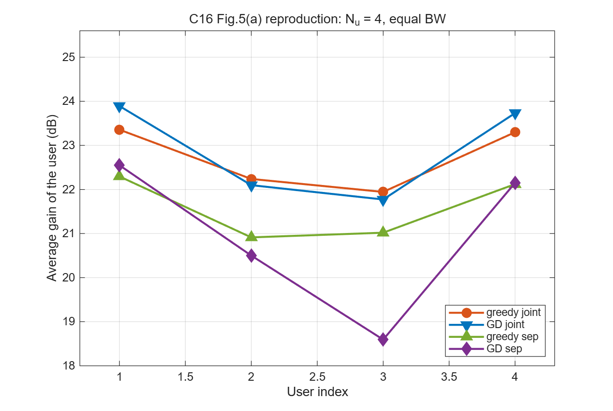
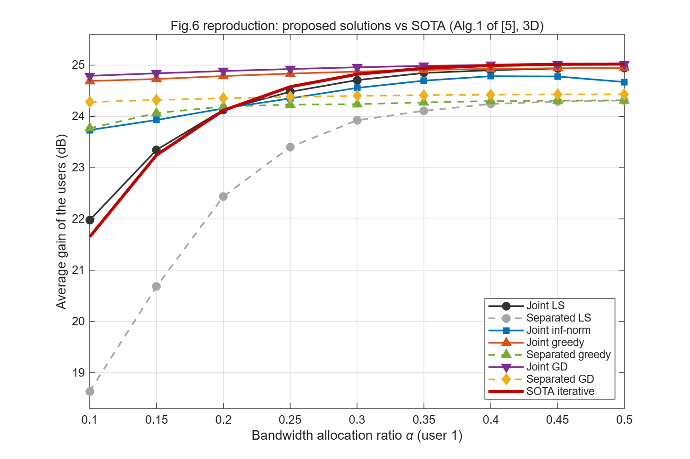

# JPTA-3D-Beamforming

中文 | [English](README.md)

本文复现以下论文的全部仿真结果：

> O. Yildiz, A. AlAmmouri, J. Mo, Y. Nam, E. Erkip, J. Zhang,
> "3D Beamforming Through Joint Phase-Time Arrays"，
> 载于*2024 IEEE 100th Vehicular Technology Conference (VTC2024-Fall)*，
> Washington, DC, USA，2024年10月7–10日，第1–7页。
> DOI [10.1109/VTC2024-Fall63153.2024.10757955](https://doi.org/10.1109/VTC2024-Fall63153.2024.10757955)
> &middot; [IEEE Xplore](https://ieeexplore.ieee.org/document/10757955)

联合相位-时延阵列（JPTA）在每个天线阵元后接一个真时延（TTD）单元，使模拟波束具有频率相关性，
于是一个射频通道就能以频分方式同时服务多个不同方向的用户。本文处理的是早期一维"彩虹波束"工作
留下的设计问题：**给定一组各占连续子带的用户，平面阵的二维移相器与时延单元应当如何取值，
才能使每个用户在自己子带内拿到尽可能大的增益？**论文给出了解析最小二乘解、∞-范数变体、
贪心算法与梯度下降算法，并把它们相互对比。

本仓库是对论文中所有可仿真结果（Fig.2–7）的独立实现，并附逐点数值对照与全部不复现项的清单。

> **产出方式**：代码、数值与本说明均由**DeepSeek-V4.1-Flash**完成，未接触作者原始代码。
> 唯一例外是Fig.6/Fig.7所用的对照基线（论文的文献[5]）：它按已发表的算法重新实现，见§6。

- 对照报告（逐图表格、缺口清单、实现坑）：[`REPORT.zh.md`](REPORT.zh.md)（[English](REPORT.md)）
- 仿真代码：[`matlab/`](matlab/)
- 论文原文：`3D Beamforming Through Joint Phase-Time Arrays (IEEE VTC2024-Fall).pdf`

---

## 1 结果一览

| 图 | 内容 | 结论 |
|---|---|---|
| Fig.2(a) | 平均增益 vs带宽分配$\alpha$，2用户，四种设计 | 逐点复现；联合减分离**0.63–3.34 dB**（论文0.6–4），均值1.36/1.11 dB（论文1.29/1.18） |
| Fig.2(b) | 5用户逐用户增益与公平性 | 4种设计中3种偏差≤0.2 dB；分离∞-范数不中（5.35 dB vs 3.2，缺口**G1**） |
| Fig.3 | 方位-俯仰图样，联合 vs分离 | 定性一致（分离方案把条纹状旁瓣铺满整个面）；带内目标比峰值低3.8 dB，与Fig.2(b)自洽 |
| Fig.4 | 5用户方位-频率热图 | 用户3被限定在**[−9.48, 9.48] MHz**（论文[−9.5, 9.5)），带内22.04 dB、带外8.14 dB |
| Fig.5 | 贪心（Algorithm 1）与Adam梯度下降，联合/分离 | 终点**逐用户≤0.4 dB**；贪心≡Algorithm 1校验到3.6e−14；论文"+2.26/+2.11 dB提升量"不复现（缺口**G5**） |
| Fig.6 | 与文献[5]的Algorithm 1对比 | 形态与定性判据成立，但"最多**1.54 dB**"只复现出**0.33 dB**（缺口**G7**） |
| Fig.7 | 耗时，梯度下降 vs SOTA迭代 | 比值**8.5–23.4×**（论文5.5×）；"至少5倍"成立，绝对值属实现性质 |

两条判据用一种不依赖读图的方式核过：

1. **论文的贪心就是Algorithm 1**——增量实现（只更新一个阵元、复用其余项）与字面实现
   （每个候选完整重算式(5)）在同一搜索网格上差$3.6\times10^{-14}$，因此后续可以把"算法不同"
   与"实现不同"分开讨论；
2. **目标不可能超过阵列上界**——$10\log_{10}(16\times24)=25.843$ dB，全程观测到的最大值
   为25.8433 dB。

---

## 2 快速开始

```matlab
cd matlab
run_all              % 自检 + 全部七组实验，约5 min
```

单独跑某一项（每个任务只改写自己在`matlab/out/`下的文件）：

```matlab
run_all('selftest')   % 内核自检4条断言            ~1 s
run_all('fig2a')      % Fig.2(a)：2用户，增益vs alpha ~12 s
run_all('fig2b')      % Fig.2(b)：5用户逐用户增益     ~3 s
run_all('fig3')       % Fig.3与Fig.4                ~19 s
run_all('fig5')       % Fig.5：贪心与Adam GD         ~2.3 min
run_all('fig5conv')   % 只做等价性校验与起点诊断       ~40 s
run_all('fig6')       % Fig.6与Fig.7                ~70 s
```

全部参数都在`matlab/core/jp_params_c16.m`（单个结构体，每个字段都标注了它在论文中的出处）。
`run_all`会把`core/`与`alg/`加入路径，之后可直接调用底层函数：

```matlab
p = jp_params_c16();
[az, el] = jp_users_c16(2);
[phi, tau, info] = jp_design(p, az, el, [0.3 0.7], 'joint-ls');
R = jp_eval(p, phi, tau, az, el, jp_block(p, [0.3 0.7]));
```

**环境**：MATLAB R2022a及以上，不需要任何工具箱（论文建议用线性规划求∞-范数解，
这里改用核心MATLAB的`fminbnd`求解等价的凸问题，见报告§2）。已在R2026b上验证。
全程无随机量，重复运行结果一致。

---

## 3 仓库结构

```
matlab/
  run_all.m              单一入口，按图分派
  run_p0.m               内核自检（P0）：4条不变量
  run_a1.m               Fig.2(a)
  run_a3.m               Fig.2(b)
  run_a45.m              Fig.3与Fig.4
  run_a6.m               Fig.5（五段：等价性校验、5(a)、5(b)、耗时、起点约定）
  run_a6_conv.m          只做run_a6的第0段与第4段
  run_a7.m               Fig.6与Fig.7
  core/
    jp_params_c16.m      论文Table I，单个结构体
    jp_users_c16.m       Fig.2–5所用的用户方向
    jp_block.m           式(9)的子带划分
    jp_nu.m              式(9)的导向值
    jp_mvec.m            子载波序号向量m = -M/2 .. M/2
    jp_target_blocks.m   式(8)-(9)的右端b_{y,z}
    jp_unwrap_k.m        式(10)的解缠整数偏移
    jp_unwrap_k_1d.m     同上，单轴（分离设计用）
    jp_gain_freqs.m      式(3)的阵列增益，任意频率
    jp_finalize.m        由(x1,x2)解出量化的相移与时延
    jp_design.m          分派：joint-ls | joint-inf | sep-ls | sep-inf
    jp_eval.m            逐用户增益，式(5)的Gl
    jp_filldef.m          选项结构体合并
  alg/
    jp_ls_fit.m          式(11)-(13)的闭式最小二乘
    jp_inf_fit.m         ∞-范数拟合，等价的一维凸形式
    jp_greedy.m          Algorithm 1（联合）及其分离版本
    jp_greedy_naive.m    字面版Algorithm 1，仅用于等价性校验
    jp_gd.m              Adam梯度下降（联合/分离）
    jp_sota_iter.m       文献[5]的Algorithm 1，升维到3D（Fig.6/7用）
  out/                   图（入库）与.mat缓存（不入库）
REPORT.zh.md             复现报告
README.md                英文版说明
REPORT.md                英文版报告
```

硬件模型只写一次：正向在`jp_gain_freqs.m`、量化在`jp_finalize.m`，所有算法与所有图都走这两处。
这样排除了"Fig.2与Fig.3用的导向约定略有不同"这一类静默错误。

---

## 4 仿真参数

论文Table I，全部落在`jp_params_c16.m`：

| 符号 | 含义 | 取值 |
|---|---|---|
| `fc` | 载频 | 28 GHz |
| `BW` | 系统带宽 | 95 MHz |
| `df` | 子载波间隔 | 120 kHz |
| `M+1` | 子载波数 | 793（`m = −396…396`） |
| `Naz × Nel` | 平面阵 | 16×24 = 384阵元，半波长间距 |
| `tau_p` | 时延量化步长 | 2.5 ns |
| `tau_max` | 时延范围 | 200 ns |
| `beta_ps` | 移相器精度 | 6 bit |
| 上界 | 最大阵列增益 | $10\log_{10}384 = 25.843$ dB |

Fig.2–5的用户方向固定：2用户方位$[-60^\circ, 60^\circ]$；5用户方位$[-60,-30,0,30,60]^\circ$、
俯仰$[90,97.5,105,112.5,120]^\circ$。带宽占比$\alpha$在Fig.2(a)与Fig.6取`0.10:0.05:0.50`，
在Fig.2(b)–Fig.5取`[0.3 0.2 0.15 0.1 0.25]`。

---

## 5 复现结果

<table>
<tr>
<td align="center"><br><sub>Fig.2(a) — 增益vs带宽分配，2用户</sub></td>
<td align="center"><br><sub>Fig.2(b) — 5用户逐用户增益</sub></td>
</tr>
<tr>
<td align="center"><br><sub>Fig.4 — 方位-频率热图</sub></td>
<td align="center"><br><sub>Fig.3 — 方位-俯仰图样（联合）</sub></td>
</tr>
<tr>
<td align="center"><br><sub>Fig.5(a) — 贪心与GD，4用户</sub></td>
<td align="center"><br><sub>Fig.6 — 与文献[5]的Algorithm 1对比</sub></td>
</tr>
</table>

### 5.1 Fig.2(a)：联合优于分离，差多少

平均增益$\frac1{N_u}\sum_i 10\log_{10}\bar G_i$（dB）：

| $\alpha$ | Joint-∞ | Joint-LS | Sep-∞ | Sep-LS | Δ(J−S) LS | Δ(J−S) ∞ |
|---|---|---|---|---|---|---|
| 0.10 | 23.734 | 21.975 | 21.847 | 18.634 | +3.34 | +1.89 |
| 0.20 | 24.154 | 24.129 | 22.824 | 22.439 | +1.69 | +1.33 |
| 0.30 | 24.555 | 24.708 | 23.631 | 23.925 | +0.78 | +0.92 |
| 0.40 | 24.784 | 24.901 | 24.012 | 24.242 | +0.66 | +0.77 |
| 0.50 | 24.671 | 24.944 | 23.951 | 24.312 | +0.63 | +0.72 |

| 判据 | 论文 | 复现 |
|---|---|---|
| 联合恒优于分离，差值在0.6–4 dB内 | 0.6–4 dB | **0.63–3.34 dB** |
| 差值均值（LS） | 1.29 dB | **1.36 dB** |
| 差值均值（∞-范数） | 1.18 dB | **1.11 dB** |
| $\alpha\le0.2$时∞-范数优于LS | 是 | 是（联合+1.76/+0.58/+0.03 dB，分离+3.21/+1.72/+0.39 dB） |

### 5.2 Fig.2(b)：五个用户

| 方案 | U1 | U2 | U3 | U4 | U5 | 用户间最大差 | 论文 |
|---|---|---|---|---|---|---|---|
| Joint-∞ | 19.42 | 19.70 | 22.55 | 20.33 | 19.34 | **3.20** | 3.0 |
| Joint-LS | 23.10 | 18.11 | 20.97 | 19.68 | 22.77 | **4.98** | 5.0 |
| Sep-∞ | 16.73 | 18.50 | 21.19 | 19.74 | 15.84 | 5.35 | 3.2 |
| Sep-LS | 20.41 | 14.95 | 19.46 | 20.56 | 20.28 | **5.61** | 5.4 |

四项中三项吻合到0.2 dB。第四项属口径问题而非调参问题：对每个轴各做一次∞-范数最小化，
与"用户看到的乘积增益的最大差最小"并不等价（缺口**G1**）。

### 5.3 Fig.3与Fig.4

一条意外但有力的校验：论文说用户3占$[-9.5, 9.5)$ MHz，而式(9)的子载波规则给出
$m=-79\ldots79$，即$[-9.48, 9.48]$ MHz——吻合到0.02 MHz，独立佐证了子带边界的取整约定。

用户3的带内增益22.04 dB，上限25.84 dB，即5用户等带宽下联合LS本身有约3.8 dB固损，
与Fig.2(b)逐用户值在19–23 dB徘徊完全一致。分离方案则是把条纹状旁瓣铺满整个方位-俯仰面，
而不是五个紧凑亮斑。

### 5.4 Fig.5：贪心与梯度下降

$N_u=4$、等带宽，逐用户增益（dB）：

| 方案 | U1 | U2 | U3 | U4 | 均值 | 迭代 |
|---|---|---|---|---|---|---|
| 联合LS（起点） | 23.27 | 21.76 | 21.36 | 23.19 | 22.394 | – |
| 联合贪心（Alg.1） | 23.36 | 22.24 | 21.94 | 23.30 | **22.709** | 4 |
| 联合Adam GD | 23.89 | 22.10 | 21.77 | 23.73 | **22.874** | 194 |
| 分离贪心 | 22.30 | 20.91 | 21.02 | 22.12 | **21.587** | 8 |
| 分离Adam GD | 22.55 | 20.50 | 18.59 | 22.15 | 20.949 | 77 |
| *论文*联合贪心 | 23.35 | 22.25 | 21.90 | 23.05 | *22.64* | |
| *论文*联合GD | 23.50 | 21.85 | 21.70 | 23.45 | *22.62* | |
| *论文*分离贪心 | 21.70 | 21.10 | 21.10 | 22.35 | *21.56* | |
| *论文*分离GD | 22.20 | 21.10 | 20.15 | 21.30 | *21.19* | |

（联合贪心逐用户≤0.25 dB，联合GD≤0.39 dB；"性能相当"成立，$|\text{GD}-\text{贪心}|$
均值0.088 dB（联合）、0.194 dB（分离）。）

有三处论文没写、但不补上就跑不通的地方：同一个学习率0.1无法同时服务$\varphi$（弧度）与
$\tau$（秒）（缺口**G2**）；Adam在无约束下几步就跳出可行的时延窗口（缺口**G3**）；
Algorithm 1的收敛判据直接用在GD上会在第一次迭代就判收敛（缺口**G4**）。三条都写在报告§5。

### 5.5 Fig.6与Fig.7：与SOTA对比

对照基线是本论文文献[5]中那篇JPTA原始论文的Algorithm 1，这里升维到3D。它在单用户全带上
拿到25.843 dB，并在自己的泛函上优于C16的解析解（$\alpha=0.5$时$F=14047.0$ vs $13928.3$），
所以不是一个被做弱的对手。

| 判据 | 论文 | 复现 |
|---|---|---|
| $\alpha>0.35$时各联合算法趋于同一结果 | 定性 | **成立**：五种联合方法极差0.22/0.24/0.35 dB |
| $\alpha\le0.35$时一次解析解最多超SOTA 1.54 dB | 1.54 dB | **0.33 dB**——不复现，缺口**G7** |
| $\alpha\le0.2$时GD+分离优于除GD+联合外的方法 | 定性 | **成立**（$\alpha=0.10$时24.28 vs 23.73 dB） |
| GD至少比SOTA迭代慢5倍 | ≥5× | **8.5–23.4×**，均值12.5×（论文5.5×） |

那1.54 dB是本文唯一复现不出的数字，但原因可诊断：两个设计优化的是不同泛函
（$\sum_k\sqrt{G_k}$，每个*子载波*等权 vs $\sum_i\log$逐用户均值，每个*用户*等权）。
按自己的泛函评，SOTA每一档都赢；按C16的泛函评，它在$\alpha<0.25$输。所以"落后1.54 dB"里
一部分是"用A的尺子量B的设计"。剩下的部分定不下来，因为论文只写"用式(8a)或Lemma 1计算
$\tau_n$"，而这两条路在本问题里相差8 dB（缺口**G7**）。

---

## 6 已记录的偏差

| 编号 | 项 | 处理 |
|---|---|---|
| **G1** | 分离∞-范数：5.35 dB vs论文3.2 | 逐轴minimax不等于乘积增益的minimax，两种读法都报 |
| **G2** | 对$\varphi$与$\tau$用同一个学习率0.1 | 改写到唯一使"0.1 rad"成立的变量对 |
| **G3** | 无约束Adam跳出$\tau\in[0,200]$ ns | 有界重参数化$b=B_{\max}\sigma(u)$ |
| **G4** | 贪心的收敛判据不适用于GD | GD用20轮滑窗，贪心仍用逐轮判据 |
| **G5** | "+2.26/+2.11 dB提升量" | 终点复现、增量不复现：它要求起点20.4–20.6 dB，即分离LS，而非论文所画的联合LS |
| **G6** | 分离GD在用户3上低1.56 dB | 留待未解；方向（分离更差）与论文一致 |
| **G7** | Fig.6的"1.54 dB" | Lemma 1口径0.33 dB、式(8a)口径8.71 dB，正文未说用哪个 |
| **G8** | 多用户FDM下目标波束$\bar b_k$为本复现的扩展 | 取唯一自洽选择，用$|\bar b_k^\dagger TPd_k|=\sqrt{G_k}$锚定 |
| **G9** | 3D升维时TTD个数未给 | 取$N=M=384$（每阵元一个），与本文硬件一致 |

---

## 7 实现坑

按踩到的顺序；完整清单见[`REPORT.zh.md`](REPORT.zh.md)§10。

1. **式(3)的子载波相位里已经含$\pi$。**`jp_nu`返回
   $\nu=y\pi\sin\theta_{az}\sin\theta_{el}+z\pi\cos\theta_{el}$，增益表达式里再乘一次$\pi$，
   相位差被放大$\pi$倍，自检给出8.35 dB而不是25.84 dB。这个17 dB的错误在没有第一条断言时
   完全看不出来。
2. **执行机没有`linprog`。**∞-范数拟合改写为等价的一维凸问题（给定斜率$x_2$，最优截距是
   $b-x_2m$的中值，而$t(x_2)$是凸函数），用`fminbnd`精确求解：不依赖工具箱，比逐阵元LP快约10倍。
3. **解缠约定决定Fig.2(a)能否复现。**加上式(10)的整数$2\pi k_i$才使解析目标可用；直接用原始
   导向值，$N_u=2,\alpha=0.1$处给出−3.05/−4.60 dB，而论文是22.1/18.1 dB。
4. **字面版Algorithm 1慢150倍但数值完全相同。**正因如此它留在仓库里：它是"快版本就是同一个
   算法"的证据。
5. **MATLAB控制台编码。**执行机`-batch`跑在GBK控制台上，所有控制台输出均为ASCII；
   中文只出现在文档里。

---

## 8 自检

`run_all('selftest')`在任何实验之前先断言四条不变量。由于目标有已知上界，它同时充当单元测试：

| # | 不变量 | 结果 |
|---|---|---|
| 1 | $N_u=1,\alpha=1$退化为纯相控阵：时延为常数、增益频平 | PASS：$\max\vert\tau\vert=0$，增益25.839 dB，纹波0.003 dB |
| 2 | 任何解不超过$10\log_{10}(16\times24)=25.843$ dB | PASS：最大25.8433 dB |
| 3 | 俯仰维为1时联合解与分离解完全一致 | PASS：$\max\vert\Delta G\vert=0$，$\max\vert\Delta\tau\vert=0$ |
| 4 | 所需时延落在$\tau_{\max}=200$ ns内 | PASS：$N_u$=2/4/8/16对应15.5/33.8/78.0/133.9 ns |

---

## 9 姊妹仓库

同组另外两篇JPTA论文以同样方式复现：

| 仓库 | 论文 | 补充内容 |
|---|---|---|
| `JPTA-Paradigm` | Ratnam等，*Joint Phase-Time Arrays: A Paradigm for Frequency-Dependent Analog Beamforming in 6G*，IEEE Access 2022 | JPTA原始框架、Algorithm 1–3、与HBF的对比；**即本论文的文献[5]** |
| `JPTA-System-Design` | Mo等，*Beamforming with Joint Phase and Time Array: System Design, Prototyping and Performance*，IEEE Asilomar Conf. 2024 | 二维type-1/type-2码本、TTD分辨率、系统级吞吐 |
| `JPTA-Uplink-Coverage` | AlAmmouri等，*Extending Uplink Coverage of mmWave and Terahertz Systems Through JPTA*，IEEE Access 2022 | 上行链路预算、HARQ、覆盖半径标度 |

三者的阵列、设计变量与优化目标都不同，因此各自有独立内核；模型对照见
[`REPORT.zh.md`](REPORT.zh.md)§11。

---

## 10 未覆盖

- Fig.1是框图、Table I是参数表，都不需要仿真；
- 3D硬件原型演示不在范围内（需要实测平台）；
- TTD个数只在$N=M$处扫描，$N<M$（子阵共享时延）留作报告§9的开放问题：它只会让基线更弱，
  因此可能是那缺失的1.54 dB的另一个来源。

---

## 引用

```bibtex
@inproceedings{yildiz2024jpta3d,
  title     = {3D Beamforming Through Joint Phase-Time Arrays},
  author    = {Yildiz, Ozlem and AlAmmouri, Ahmad and Mo, Jianhua and Nam, Younghan
               and Erkip, Elza and Zhang, Jianzhong},
  booktitle = {2024 IEEE 100th Vehicular Technology Conference (VTC2024-Fall)},
  address   = {Washington, DC, USA},
  pages     = {1--7},
  month     = oct,
  year      = {2024},
  doi       = {10.1109/VTC2024-Fall63153.2024.10757955}
}
```

本仓库为独立实现，未使用作者原始代码。所有与已发表数值的偏差都列在
[`REPORT.zh.md`](REPORT.zh.md)中。
